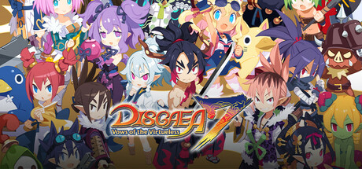

**Disgaea 7: Vows of the Virtueless is set in Hinomoto, a Japan-inspired Netherworld, following Fuji opposing the Demonic General's oppressive rule. Features Jinraiki giant character transformations for overwhelming power and the series' most colorful cast in years.**

---

## 📖 About

Disgaea 7: Vows of the Virtueless is set in Hinomoto, a Japan-inspired Netherworld, following Fuji opposing the Demonic General's oppressive rule. Features Jinraiki giant character transformations for overwhelming power and the series' most colorful cast in years.

## ⚠️ Problems Without Trainer

| Problem | Status |
|---------|--------|
| **Jinraiki Activation** — Giant mode has limited turns requiring strategic deployment timing | ✅ Solved |
| **Item World Gauntlets** — Post-game Item World content is far harder than story completion | ✅ Solved |
| **Rosen Queen Management** — Unlocking shop inventory tiers requires grinding Mana points | ✅ Solved |
| **Rank 40 Equipment** — Getting top-tier gear requires extensive post-game Item World diving | ✅ Solved |

## ✅ Solution

The **Disgaea 7 Trainer** solves all these issues by giving you complete control over the game.

## 🎯 Full Feature List

- Unlimited Resources
- God Mode / Invincibility
- Instant Skill Cooldown
- One-Hit Kill
- Freeze Game Timer
- Unlock All Items & Achievements
- Custom Speed Multiplier
- Save State Anywhere

## 🚀 Quick Start

1. **Disable Windows Defender** temporarily (trainer may trigger false positive)
2. Download the trainer from the button above
3. Launch Disgaea 7
4. Run the trainer as Administrator
5. Activate desired cheats with hotkeys

## 💎 Free vs Paid

| Feature | Free | Pro |
|---------|------|-----|
| Basic God Mode | ✅ | ✅ |
| Unlimited Resources | ✅ | ✅ |
| All Advanced Cheats | ❌ | ✅ |
| Auto-Updates | ❌ | ✅ |
| Priority Support | ❌ | ✅ |

## 💻 Requirements

- Windows 10/11 (64-bit)
- Disgaea 7 (any version)
- .NET Framework 4.8+
- DirectX 11+

## 🍎 macOS

macOS users can use our alternative tool:

## ⚖️ Legal

This trainer is for educational and single-player use only. Use responsibly.

---

